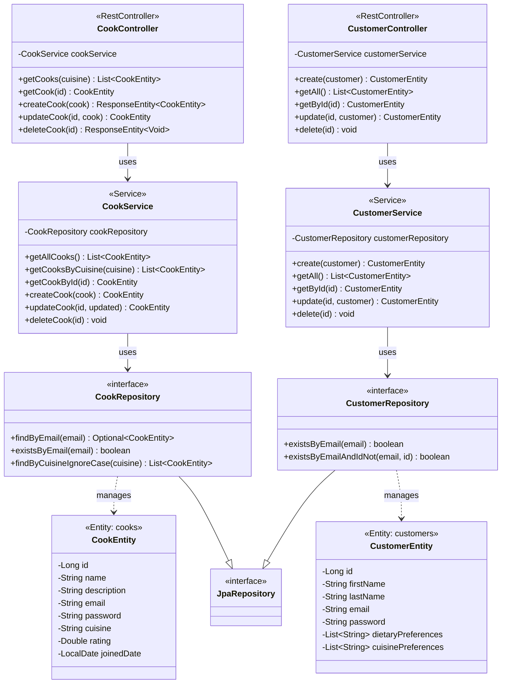

# MealShare backend API

REST API for MealShare, an app that connects customers with local home cooks and caterers. Built with Spring Boot, Spring Data JPA and PostgreSQL (Neon), and deployed to Render with Docker.

**Version:** 1.0

**Base URL**

- local: `http://localhost:8080/api`
- production: `https://team-13-repo.onrender.com/api/cooks`
`https://team-13-repo.onrender.com/api/customers` 

> **Cold start:** the free Render instance sleeps when idle, so the first request after a quiet period can take up to a minute. Later requests are fast.

Error codes used: `404 Not Found` for a missing record, `409 Conflict` for a duplicate email, and `400 Bad Request` for invalid customer input.

## UML class diagram



## Cook endpoints

Base path: `/api/cooks`

| Method | Path | Description | Success | Error codes | User story | Implemented by |
| ------ | ---- | ----------- | ------- | ----------- | ---------- | -------------- |
| `POST` | `/api/cooks` | Register a cook profile | `201 Created` | `409` | US-5 Create and update a catering profile | Jace Tillman, Cali Hunt |
| `GET` | `/api/cooks` | List all cooks | `200 OK` | n/a | US-2 View cooks by cuisine and dietary preferences | Jace Tillman, Cali Hunt |
| `GET` | `/api/cooks?cuisine=Asian` | Filter cooks by cuisine (case-insensitive) | `200 OK` | n/a | US-2 View cooks by cuisine and dietary preferences | Jace Tillman, Cali Hunt |
| `GET` | `/api/cooks/{id}` | Read one cook profile | `200 OK` | `404` | US-2, US-5 | Jace Tillman, Cali Hunt |
| `PUT` | `/api/cooks/{id}` | Update a cook profile | `200 OK` | `404` | US-5 Create and update a catering profile | Jace Tillman, Cali Hunt |
| `DELETE` | `/api/cooks/{id}` | Remove a cook profile | `204 No Content` | `404` | US-5 (provider can remove their profile) | Jace Tillman, Cali Hunt |

Cook fields:

| Field | Type | Rules |
| ----- | ---- | ----- |
| `id` | Long | Generated by the database, not sent in requests |
| `name` | String | Required |
| `description` | String | Optional, up to 1000 characters |
| `email` | String | Required and unique. A duplicate on `POST` returns `409` |
| `password` | String | Required on `POST`. Accepted in requests but never returned. On `PUT` it is only changed if a new one is sent |
| `cuisine` | String | Optional, for example Italian, Asian, Mexican |
| `rating` | Double | Optional |
| `joinedDate` | LocalDate | Optional, format `yyyy-MM-dd`. Defaults to today on `POST` |

### Example request body (POST and PUT /api/cooks)

```http
POST /api/cooks
Content-Type: application/json

{
  "name": "Maria Rossi",
  "description": "Homemade Italian meal prep and weekly dinner plans.",
  "email": "maria.rossi@example.com",
  "password": "securePass123",
  "cuisine": "Italian",
  "rating": 4.8,
  "joinedDate": "2026-09-01"
}
```

```http
PUT /api/cooks/1
Content-Type: application/json

{
  "name": "Maria Rossi",
  "description": "Italian meal prep, now with vegetarian weekly plans.",
  "email": "maria.rossi@example.com",
  "cuisine": "Italian",
  "rating": 4.9,
  "joinedDate": "2026-09-01"
}
```

### Example response (GET /api/cooks/1)

```json
{
  "id": 1,
  "name": "Maria Rossi",
  "description": "Italian meal prep, now with vegetarian weekly plans.",
  "email": "maria.rossi@example.com",
  "cuisine": "Italian",
  "rating": 4.9,
  "joinedDate": "2026-09-01"
}
```

## Customer endpoints

Base path: `/api/customers`

| Method | Path | Description | Success | Error codes | User story | Implemented by |
| ------ | ---- | ----------- | ------- | ----------- | ---------- | -------------- |
| `POST` | `/api/customers` | Register a customer | `201 Created` | `400, 409` | US-1 Register an account | Cali Hunt |
| `GET` | `/api/customers` | List all customers | `200 OK` | n/a | US-1 (admin and testing) | Cali Hunt |
| `GET` | `/api/customers/{id}` | View a customer profile | `200 OK` | `404` | US-1 Register an account (view profile) | Cali Hunt |
| `PUT` | `/api/customers/{id}` | Update profile, dietary and cuisine preferences | `200 OK` | `400, 404, 409` | US-1, US-2 (preferences drive cook discovery) | Cali Hunt |
| `DELETE` | `/api/customers/{id}` | Delete a customer account | `204 No Content` | `404` | US-1 Register an account (account management) | Cali Hunt |

`firstName`, `lastName`, `email` (valid format, unique) and `password` (at least 8 characters) are required. The password is accepted on input but never returned. A duplicate email returns `409`. `PUT` also requires a valid `password` because the whole body is validated.

### Example request body (POST and PUT /api/customers)

```http
POST /api/customers
Content-Type: application/json

{
  "firstName": "Cali",
  "lastName": "Hunt",
  "email": "cali.hunt@example.com",
  "password": "securePass123",
  "dietaryPreferences": ["High protein", "Gluten free"],
  "cuisinePreferences": ["Italian", "Mexican"]
}
```

```http
PUT /api/customers/1
Content-Type: application/json

{
  "firstName": "Cali",
  "lastName": "Hunt",
  "email": "cali.hunt@example.com",
  "password": "securePass123",
  "dietaryPreferences": ["Vegetarian"],
  "cuisinePreferences": ["Asian", "Mediterranean"]
}
```

## Not yet implemented

| User story | Status |
| ---------- | ------ |
| US-3 Order meals or subscribe to a weekly plan | Planned |
| US-4 Leave ratings and reviews | Planned |
| US-6 Display meals and set pricing | Planned |
| US-7 Respond to reviews | Planned |

## Known limitations

- **No cook input validation yet:** a `POST /api/cooks` with a missing `name`, `email` or `password` is rejected by the database and returns `500` instead of `400`. Customers already validate their input.
- **No authentication:** there is no login, and cook and customer passwords are stored as plain text (the code has a TODO to hash them). Do not use real passwords.
- **Email on update:** changing a cook's email to one that already exists is rejected by the database and returns `500` instead of `409`.

## Run locally

```bash
cd backend-api
export SPRING_DATASOURCE_URL="jdbc:postgresql://..."   # Neon connection string, never commit it
./mvnw spring-boot:run                                 # Windows: .\mvnw.cmd spring-boot:run
```

On Windows PowerShell, set the variable with `$env:SPRING_DATASOURCE_URL="..."` first. The connection string must not be written into `application.properties` or committed to Git.

## Deploy on Render

Create a Web Service from this repo with **Root Directory** `backend-api`, language **Docker**, the Free instance type, and the environment variable `SPRING_DATASOURCE_URL`.